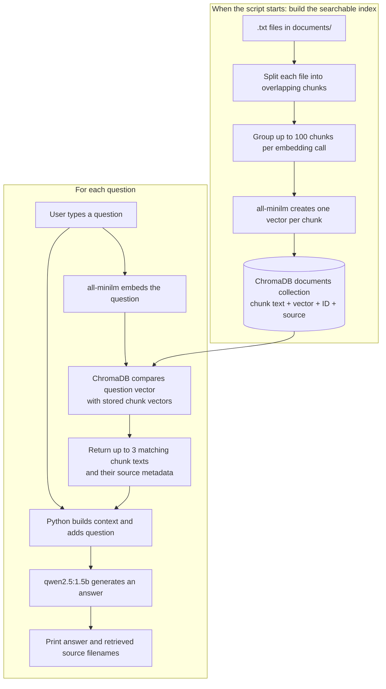

# [SmartShip RAG Demo](https://github.com/waseemmalik6191/ollama-chromadb-document-rag/blob/main/rag_demo_multiple.py)

This project is a small local Retrieval-Augmented Generation (RAG) demo that reads plain-text project documents, turns them into searchable chunks, stores them in a local vector database, and answers questions using a local LLM via Ollama.

It is designed to help you ask questions about project knowledge spread across multiple files, such as deployment procedures, testing rules, and project notes.

## What this project does

The script:

1. Looks in the `documents/` folder for `.txt` files.
2. Reads each file and splits its text into overlapping chunks.
3. Uses Ollama embeddings (`all-minilm`) to create vector representations.
4. Stores those embeddings in a persistent ChromaDB database in `chroma_db/`.
5. Accepts a user question.
6. Embeds the question, finds the most relevant text chunks.
7. Sends those chunks as context to an Ollama chat model (`qwen2.5:1.5b`).
8. Returns an answer grounded in the supplied documents.

This is a classic document Q&A pattern: retrieve relevant content, then generate a response using that content as context.

## Project structure

- `rag_demo_multiple.py` - Main application
- `documents/` - Source knowledge files in `.txt` format
- `chroma_db/` - Local vector database created automatically by Chroma
- Python packages: `chromadb` and `ollama`

## Included documents

The sample knowledge base contains:

- `deployment.txt` - production deployment rules and procedures
- `project_notes.txt` - project overview and business context
- `testing.txt` - release criteria and QA/testing requirements

These files are intentionally structured as plain text so the demo can index them like a small knowledge base.

## Code walkthrough

### 1. Setup and folder discovery

The script starts by finding the project directory and locating the `documents` folder:

```python
project_folder = Path(__file__).resolve().parent
documents_folder = project_folder / "documents"
database_path = project_folder / "chroma_db"
```

If `documents/` does not exist, it raises an error. This ensures the application is not run without source data.

### 2. Loading text files

It finds every `.txt` file recursively and fails if none are found:

```python
document_paths = sorted(documents_folder.rglob("*.txt"))
```

### 3. Chunking text

The `chunk_text()` function splits long text into smaller overlapping chunks:

```python
def chunk_text(text, chunk_size=500, overlap=80):
    chunks = []
    start = 0

    while start < len(text):
        chunk = text[start:start + chunk_size].strip()
        if chunk:
            chunks.append(chunk)
        start += chunk_size - overlap
```

The overlap helps preserve context across chunk boundaries, which is useful for retrieval.

### 4. Keeping track of chunks and their source

The script puts every chunk from every file into the `all_chunks` list. At the same time, it creates a matching ID and metadata entry for each chunk. For example, a chunk from `testing.txt` might have:

- ID: `testing.txt-chunk-2`
- metadata: `{"source": "testing.txt", "chunk": 2}`
- document text: the actual text from that part of the file

These are aligned by list position: `all_chunks[2]`, `all_ids[2]`, and `all_metadatas[2]` all describe the same chunk. The source metadata is just a label recording where the text came from. When that chunk is retrieved later, the program can print its filename. It does not record the model's reasoning.

### 5. What “batch” means here

The script sets `batch_size = 100`. A batch is simply a group of up to 100 chunks sent to the embedding model in one call; it does **not** mean all chunks in the group get one shared embedding.

The loop runs once for every group of up to 100 chunks:

```python
for start in range(0, len(all_chunks), batch_size):
    batch_chunks = all_chunks[start:start + batch_size]
    batch_embeddings = embed(model="all-minilm", input=batch_chunks).embeddings
```

Ollama returns one embedding vector for each input chunk. For example, with 11 chunks total, the script makes one embedding call containing all 11 chunks, and gets 11 vectors back. With 250 chunks, it makes three calls containing 100, 100, and 50 chunks.

### 6. How embeddings and ChromaDB fit together

An embedding is a list of numbers representing the meaning of one piece of text. The embedding model (`all-minilm`) creates these vectors for the document chunks and, later, for each question. Texts with similar meanings tend to have vectors that are close to each other.

The script creates a local ChromaDB collection called `documents`. A collection is like a table of records. For each chunk, `collection.add(...)` stores a record containing:

1. its ID (`ids`)
2. its original text (`documents`)
3. its embedding vector (`embeddings`)
4. its source and chunk number (`metadatas`)

ChromaDB persists these records under the `chroma_db/` folder. This script deletes and rebuilds the `documents` collection every time it starts, so it re-reads and re-embeds the current files rather than reusing an old index.

### 7. What happens when you ask a question

The question does not go straight to ChromaDB as ordinary text. The script first uses the **same embedding model** to turn the question into a vector:

```python
question_embedding = embed(
    model="all-minilm",
    input=question
).embeddings[0]
```

Then this call asks ChromaDB to compare the question vector with the stored chunk vectors and return the closest matches:

```python
results = collection.query(
    query_embeddings=[question_embedding],
    n_results=min(3, collection.count())
)
```

`min(3, collection.count())` means “ask for 3 results, or fewer if the collection contains fewer than 3 records.” For example:

- 11 stored chunks: request 3 nearest chunks.
- 2 stored chunks: request 2, because only 2 exist.

The results include the matching chunk texts and their metadata. The `3` is the maximum number of chunks retrieved for **each question**; it is unrelated to the indexing batch size of 100.

### 8. How the answer is produced

The script joins the retrieved text chunks into a context string, adding each chunk's source filename. It then sends both that context and the user's question to the chat model (`qwen2.5:1.5b`).

The chat model does **not** query ChromaDB itself. The Python script queries ChromaDB first, then passes the retrieved text to the chat model in its prompt. The model generates the answer from that supplied context. The script prints the answer and the source filenames for the chunks that were retrieved.

#### Flow diagram

The top half runs when the script starts and builds the index. The bottom half runs for each question:



In this diagram, the arrows show what information is passed between steps. ChromaDB does the vector search; the Python script passes the retrieved text and question to the chat model, which generates the answer.

The system prompt asks the chat model to use only the supplied context, say when the documents do not contain the answer, and avoid inventing facts. This instruction helps keep answers grounded, but an LLM can still make mistakes.

## Installation and setup

### 1. Install Python dependencies

Use Python 3 and create a virtual environment in the project folder:

```bash
python -m venv .venv
```

Activate it:

```powershell
# Windows PowerShell
.\.venv\Scripts\Activate.ps1
```

```bash
# macOS / Linux
source .venv/bin/activate
```

Install the Python packages used by the script:

```bash
python -m pip install --upgrade pip
python -m pip install chromadb ollama
```

### 2. Install Ollama and download the models

Install Ollama for your operating system from [ollama.com](https://ollama.com/), then make sure it is running. Download both models used by the script:

```bash
ollama pull all-minilm
ollama pull qwen2.5:1.5b
```

`all-minilm` creates embeddings for document chunks and questions. `qwen2.5:1.5b` generates the final answer from the retrieved chunks.

### 3. Add documents and run

Put your `.txt` files inside the `documents/` folder, then run:

```bash
python rag_demo_multiple.py
```

Ask a question in the terminal. Type `exit` to quit. Example questions:

- What are the deployment requirements?
- Who approves production release?
- What are the minimum release criteria?
- What is the project purpose?

The first run builds the local ChromaDB index from the documents before prompting for a question.

## Notes and limitations

- The script rebuilds the Chroma collection every time it runs.
- It is intended for local experiments and small document sets.
- It depends on Ollama being available locally.
- The quality of results depends on the quality of the document set and the chunk size.
- It only handles text documents (`.txt` files) in the current example.

## Summary

This project demonstrates a lightweight, local RAG pipeline using:

- text chunking
- embeddings
- vector search
- LLM-based answer generation

In plain terms: it lets you ask questions about your project documents and get answers based on the actual information stored in those documents.
